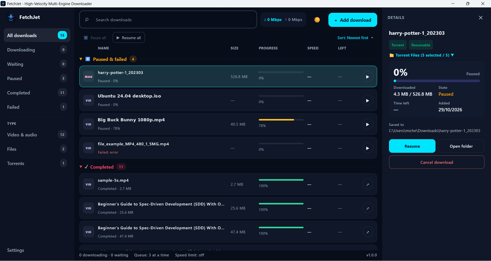
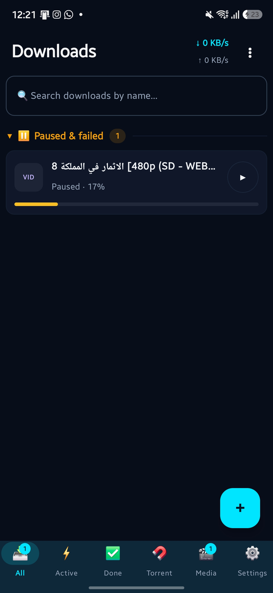
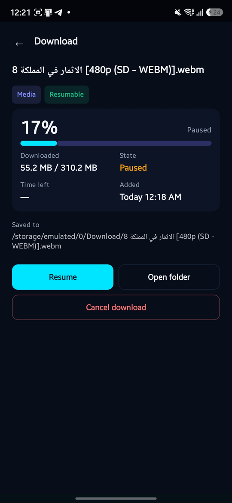

<p align="center">
  
</p>

<h1 align="center">FetchJet</h1>

<p align="center">
  <b>One download manager for everything: files, videos, playlists and torrents.</b><br>
  Windows · macOS · Linux · Android · iOS · Chrome / Edge / Firefox extension
</p>

<p align="center">
  <a href="https://the-best-is-best.github.io/FetchJet/"></a>
  <a href="https://apps.microsoft.com/detail/9NP3HJRHMPJS"></a>
  <a href="https://github.com/the-best-is-best/FetchJet/releases"></a>
  
</p>

<p align="center">
  
</p>

---

## Why FetchJet

|                                    |                                                                                                                                                                              |
|------------------------------------|------------------------------------------------------------------------------------------------------------------------------------------------------------------------------|
| ⚡ **Fast HTTP downloads**         | Files are split into chunks and fetched in parallel, resumed after a pause or a crash, and the exact downloaded bytes are shown – no jumping sizes.                          |
| 🎬 **Videos from 1000+ sites**     | YouTube, Vimeo, TikTok, Twitter/X, Instagram, Twitch, SoundCloud… Pick the quality (up to 4K / 8K), or just the audio as MP3.                                                |
| ✂️ **Clip, don't download it all** | Choose a start and end time. FetchJet fetches only that part, or grabs the whole video at full speed and cuts it locally – your choice.                                      |
| 📃 **Playlists & channels**        | Paste a playlist link, tick the videos you want, pick one quality for all of them.                                                                                           |
| 🧲 **Torrents & magnets**          | Built-in libtorrent engine. Choose files inside the torrent, set priorities, disable uploading. Torrents with web seeds (e.g. archive.org) download over HTTP at full speed. |
| 🗂️ **Queue & schedule**            | Decide how many downloads run at once; the rest wait in line. Schedule a download for tonight at 2:00 AM.                                                                    |
| 🧭 **Browser extension**           | A **Download with FetchJet** button on video pages and links; the app opens with the quality list ready.                                                                     |
| 🔁 **Resume-aware**                | FetchJet tells you whether a link can resume *before* you pause it.                                                                                                          |
| 🔔 **Live progress**               | Android live notification and iOS Live Activity with speed and time left.                                                                                                    |
| 🌗 **One UI everywhere**           | Sidebar on desktop, rail on tablets, bottom bar on phones. Dark and light.                                                                                                   |
| 🔄 **Auto-update**                 | Checks for new versions; Windows installs them for you.                                                                                                                      |

---

## Download

**👉 [Downloads page](https://the-best-is-best.github.io/FetchJet/)** – every version for every
platform, with the right file highlighted for your device.

| Platform              | File                                                                                                | Notes                                                              |
|-----------------------|-----------------------------------------------------------------------------------------------------|--------------------------------------------------------------------|
| Windows 10 / 11       | [Microsoft Store](https://apps.microsoft.com/detail/9NP3HJRHMPJS) (recommended), or `.msi` / `.exe` | The Store keeps it updated; the MSI updates itself from GitHub.    |
| macOS 12+             | `.dmg`                                                                                              | Drag FetchJet to Applications.                                     |
| Linux                 | `.deb` or `.tar.gz`                                                                                 | The tarball runs anywhere: unpack and start `bin/FetchJet`.        |
| Android 8+            | `.apk`                                                                                              | `arm64-v8a` fits almost every phone; take *universal* if unsure.   |
| iOS 16+               | `.ipa`                                                                                              | Sideload with AltStore or Sideloadly.                              |
| Chrome / Edge / Brave | `.zip`                                                                                              | Load it on `chrome://extensions` (Developer mode → Load unpacked). |
| Firefox               | [Firefox Add-ons](https://addons.mozilla.org/firefox/addon/fetchjet-download-manager/)              | Install from the store; Firefox keeps it updated.                  |

---

## A quick tour

<table>
<tr>
<td width="50%" valign="top">

### Add anything

Click **Add download**, paste a link – or a magnet, or a `.torrent` file path – and FetchJet detects
the engine. Videos get a quality list; torrents show their files; plain links start right away.

</td>
<td width="50%" valign="top">

### Cut a clip

Turn on **Clip** and set *From* / *To* down to the second. **Only the clip** saves bandwidth; **Full
video, then cut** is faster on sites that throttle partial downloads.

</td>
</tr>
<tr>
<td width="50%" valign="top">

### Playlists

Paste a playlist or channel link, untick what you don't need, pick a quality once. Each video
becomes its own download in the queue.

</td>
<td width="50%" valign="top">

### Queue & schedule

**Settings → Downloads** sets how many run at once. In the Add dialog, **Start → At a time** picks
the hour and the day. Running downloads always sit on top of the list.

</td>
</tr>
</table>

<p align="center">
  
  &nbsp;&nbsp;
  
</p>

---

## Browser extension

1. Install the extension (see the table above) and start FetchJet.
2. Open a video page or hover a download link: a **Download with FetchJet** button appears.
3. Click it – the app comes to the front with the link, the qualities and the cookies it needs for
   sites that require a login.

If FetchJet is not running, the extension tells you, and the plain browser download still works.

---

## Tips

- **Pause all / Resume all** live above the list (desktop & tablet) and in the ⋮ menu on phones.
- **Search** filters by file name or link.
- Click a download to open its details: exact bytes, speed, time left, the saved path, and the
  actions for that item.
- A download that **cannot resume** is marked *No resume*; pausing it starts over, and FetchJet asks
  first.
- **Settings → Media tools** shows whether yt-dlp and FFmpeg are installed and updates them with one
  click.
- **Settings → General** can start FetchJet with the system (hidden in the tray), so scheduled
  downloads and the extension always find it.

---

## Privacy

FetchJet talks only to the sites you download from, to GitHub (for update checks) and – for Firefox
signing in CI – to Mozilla. No analytics, no accounts.

---

## Building from source

<details>
<summary>Developers: click to expand</summary>

FetchJet is a **Kotlin Multiplatform** / **Compose Multiplatform** project.

| Module         | What it is                                                                                  |
|----------------|---------------------------------------------------------------------------------------------|
| `sharedLogic/` | Engines (HTTP chunks, yt-dlp media, libtorrent), queue, scheduling, updates – all platforms |
| `sharedUI/`    | The Compose UI shared by desktop, Android and iOS                                           |
| `desktopApp/`  | JVM app (Windows / macOS / Linux installers via jpackage)                                   |
| `androidApp/`  | Android app                                                                                 |
| `iosApp/`      | Xcode project (SwiftUI shell, Live Activity, native bridges)                                |
| `extension/`   | Chrome / Firefox extension                                                                  |
| `docs/`        | The downloads page (GitHub Pages)                                                           |

```bash
# Desktop
./gradlew :desktopApp:run            # run
./gradlew :desktopApp:hotRun --auto  # hot reload
./gradlew :desktopApp:packageMsi     # installer for the current OS (packageDmg / packageDeb)

# Android
./gradlew :androidApp:assembleDebug

# iOS
open iosApp/iosApp.xcodeproj         # build & run from Xcode

# Browser extension
./extension/build.sh                 # -> build/extension/*.zip and *.xpi
```

Releases are built by GitHub Actions: push a `v1.2.3` tag for all platforms, or run the workflow by
hand and tick only the platforms that changed. See `.github/workflows/build.yml`.

Set `fetchjet.verboseLogs=true` in `gradle.properties` (or the `FETCHJET_VERBOSE_LOGS` env var) for
a build with detailed engine logs; on desktop the log is at `~/.fetch_jet/logs/app.log`.

</details>

---

## License

See [LICENSE](LICENSE). Third-party components are listed
in [THIRD_PARTY_NOTICES.md](THIRD_PARTY_NOTICES.md).
